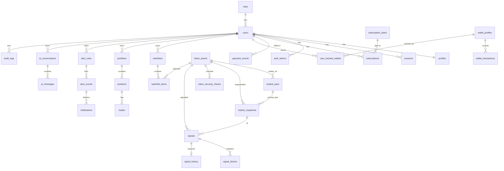

# Architecture

## Overview

```mermaid
flowchart LR
  subgraph Providers
    DS[DexScreener<br/>pairs, prices, txns]
    GT[GeckoTerminal<br/>OHLCV, trending, new pools]
    GP[GoPlus<br/>token security]
    HE[Helius<br/>RPC, wallets, live feed]
  end
  subgraph Worker["Background worker (in-process, npm run worker, or /api/cron/tick)"]
    Q[(jobs table<br/>SKIP LOCKED queue)]
    ING[Ingestion cycle]
    SC[Scoring engine<br/>pure, deterministic]
    AL[Alert evaluator + delivery]
    TR[Outcome tracker]
    WS[Wallet sync]
  end
  subgraph App["Next.js app (server components + route handlers)"]
    PAGES[Marketing · Dashboard · Admin]
    API[/api/*]
    AI[AI chat: tool-use loop]
  end
  DB[(PostgreSQL<br/>RLS for user data)]
  DS & GT & GP --> ING --> SC --> DB
  HE --> WS --> DB
  Q --> ING & AL & TR & WS
  AL --> EM[Resend email] & TG[Telegram]
  PAGES & API --> DB
  AI -->|"tools read DB only"| DB
  AI --> CL[Anthropic API]
  API --> ST[Stripe] -->|signed webhooks| API
```

### Key decisions

| Decision | Why |
|---|---|
| **One Next.js app** for marketing, dashboard, API and admin | One deployable, shared types, server components query the DB directly. |
| **Plain SQL migrations + thin query layer** (`src/lib/db`) | Same SQL runs on production Postgres and on embedded **PGlite** for zero-setup dev and isolated tests — including RLS. No ORM dependency. |
| **Custom session auth** (scrypt N=2^17, 32-byte random tokens hashed in DB, httpOnly SameSite=Lax cookies) | Self-contained, no external IdP required; Supabase Auth or an OAuth provider can be added later (see Limitations). |
| **Postgres job queue** (`FOR UPDATE SKIP LOCKED`, slot-based dedup keys) | Avoids a Redis dependency; safe across multiple worker instances; idempotent scheduling. |
| **Centralized ingestion** | Providers are polled once per cycle for everyone; per-provider token buckets, TTL caches and in-flight dedup (`src/lib/providers/http.ts`). |
| **Deterministic scoring, LLM only explains** | Scores are reproducible and auditable; the model reaches data only through server-side tools. |
| **Stripe via REST + manual signature verification** | No SDK dependency; HMAC-SHA256 with timestamp tolerance and constant-time compare. Entitlements change only from verified webhooks or audited admin grants. |
| **SSE + interval refresh** | Signals are produced once per cycle, so near-real-time push (SSE every 15s) is honest; we do not claim tick-level real time. |

## Request security

- `src/proxy.ts` performs an **optimistic** cookie-presence redirect for `/app` and `/admin`; authoritative checks run in layouts (`requirePageUser/requirePageAdmin`) and in every route handler (`requireUser/requireRole`).
- All mutating API calls go through `api()` (`src/lib/http.ts`), which enforces a **same-origin check** (CSRF), Zod validation and uniform error responses that never leak internals.
- User-owned data is accessed through `withUser(userId, …)`, which runs the transaction as the non-owner role `nexalpha_app` with `app.user_id` set — **Postgres RLS** then scopes every statement. Tested in `tests/unit/db-rls.test.ts`.
- Rate limits are stored in Postgres (work across instances): login, signup, reset, AI, search, checkout, etc.
- Admin actions, auth events and billing changes are written to `audit_logs`.
- Security headers: `X-Frame-Options: DENY`, `nosniff`, `Referrer-Policy`, `Permissions-Policy`.

## Ingestion → signal pipeline (`src/lib/ingestion/pipeline.ts`)

1. **Candidates**: watchlisted tokens, tokens with recent signals, open positions (always refreshed) + DexScreener boosts/profiles + GeckoTerminal trending/new pools per chain. Deduplicated by `(chain, normalized address)`, capped per cycle.
2. **Market data**: DexScreener `tokens/v1` batches of 30; the deepest-liquidity pair where the token is the base asset becomes primary. Token, pair and a timestamped **snapshot** are upserted.
3. **Spam filter** (`spam.ts`): no price, ticker impersonation of canonical assets, scam-like names, implausible FDV vs liquidity, liquidity > 5× cap, anomalous % moves, implausible volume per txn. Flagged tokens are hidden by default — the filter does not claim to catch all scams.
4. **Security** (`providers/goplus.ts`): chain-specific normalization; refreshed every `security_ttl_hours` (1h for "unavailable"), ≤15 per chain per cycle. Missing provider data → `unavailable` / `unknown` risk, never clean.
5. **Scoring** (`scoring/engine.ts`): 11 factors → quality, momentum, risk, confidence, AI score; classification into momentum / accumulation / breakout_watch / distribution / high_risk; eligibility rules; ATR scenario levels when ≥20 candles exist (candles fetched only for eligible bullish candidates).
6. **Signal** creation with dedup window and rescore delta; factors stored per signal with the scoring version.
7. **Outcome tracking** fills `signal_history` from later snapshots (1h/6h/24h, max/min, TP/invalidation hits).
8. **Alerts** are evaluated after each cycle; notifications delivered with retries.

## Data model (ER overview)



Operational tables: `api_provider_status`, `app_settings` (scoring weights, ingestion settings, last cycle status), `jobs`, `rate_limits`, `email_outbox`, `support_tickets`, `app_logs`, `schema_migrations`.

Identity rules: tokens are unique on `(chain, address)` with Solana base58 addresses kept case-sensitive (`normalizeAddress`). Wallet classifications other than `unknown`/`user_labeled` require `classification_source` (DB `CHECK`).

Migrations live in `db/migrations/*.sql` and are embedded into the bundle (`scripts/embed-migrations.mjs`) so serverless deployments can migrate without filesystem access.

## Entitlements

Plans (`subscription_plans.features` JSON) define chains, signal delay/history/feed size, advanced filters, watchlist/portfolio/alert/wallet limits, alert channels, AI quota, deep analysis, Smart Money, whale alerts, intelligence level and priority support. `getEntitlements()` resolves the active subscription (active/trialing within the period, or past_due within a 3-day grace) and is called server-side by every gated query and route. Prices, Stripe Price IDs and every limit are editable in Admin → Pricing.

## AI (`src/lib/ai`)

`runChat` drives a manual tool-use loop (≤6 rounds) on `client.beta.messages.create` with server-side refusal fallbacks enabled (`server-side-fallback-2026-07-01`, `fallbacks: "default"`). Tools: `search_tokens`, `get_token_report`, `get_signal`, `get_token_signals`, `get_market_overview`, `get_wallet_activity`, `list_my_watchlist` — each returns stored/deterministic data with `as_of` timestamps and respects the user's plan chains. Usage, tokens and estimated cost are stored per reply; daily quotas per plan; per-minute rate limit.
